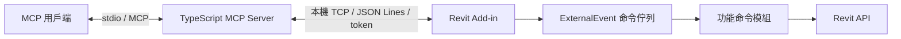

# TYBIM Revit MCP

適合持續擴充的 Revit MCP 基礎專案，預設 Revit 2025，並支援 Revit 2024 分版編譯。

**v0.5.0：新增 Revit 2024／2025 的 Visual Studio Setup Project 與獨立 MSI。** DLL／runtime 部署到 `Addins/TYBIM_MCP/<年份>`，年度 `.addin` 保留在 `Addins/<年份>`；相機管理按鈕可再次點擊收合。安裝檔與重建方式見 [Setup 操作說明](TYBIM_MCP_Setup/README.md)。本次沒有發布 2026／2027 MSI。

**v0.4.1：修正 StudyCatalog 共用命令別名造成的啟動例外。** 保留 258 個 MCP 工具；新增實際 C# 靜態初始化回歸測試，建置與打包前皆執行。

**v0.4.0：新增 REVIT_MCP_study 的 220 個已實作工具，預設共 258 個工具。** 外來原始快照、適配版與私人功能分開管理，詳見 [Study 整合與安裝](docs/study-integration.md) 及 [程式分類與更新方式](docs/source-ownership.md)。整體專案與安裝包供私人／內部使用，不是公開發布套件。

**v0.3.0：整合 mcp-servers-for-revit 的 23 個 Revit 指令與 3 個 SQLite 工具。** 連同原工具與新增狀態查詢，共 38 個 MCP 工具，統一在「拓源數位 → MCP → AI助手」使用。完整功能、程式位置、來源授權與實測限制見 [上游功能整合說明](docs/upstream-integration.md)。

**v0.2.0：新增 Revit 內嵌 AI 對話面板。** 於 Revit「拓源數位 → MCP → AI助手」切換 Codex、Claude、Gemini。Codex 使用官方登入，Claude／Gemini 使用獨立 API Key。
完整安裝、登入與使用步驟請先看 [內嵌 AI 對話操作說明](docs/embedded-chat.md)。
建置後執行 `scripts/Package-Chat.ps1` 產生完整面板套件；早期的 `Prepare-Package.ps1` 只準備核心 bridge，不含面板 runtime。



第一階段提供四個唯讀工具：`revit_health`、`revit_project_info`、`revit_get_selection`、`revit_get_levels`。
另提供 `revit_hello_world`，在 Revit 中顯示「Hello World！」視窗，不修改模型。按下「確定」後才回傳；若等待超過通訊逾時，視窗仍會保留，請手動關閉，勿自動重送。新增此工具後必須關閉 Revit、更新外掛套件再重啟。
牆中點放門使用 `revit_get_door_placement_context` → `revit_preview_doors_at_wall_centers` → `revit_execute_doors_at_wall_centers`，另以 `revit_get_door_operation_status` 查詢結果。詳見 [放門流程](docs/door-placement.md)。
樓層高程使用毫米，元素 ID 使用字串，避免 JavaScript 整數精度問題。

## 專案結構

| 路徑 | 用途 |
|---|---|
| `TYBIM.MCP.sln` | Visual Studio C# 解決方案 |
| `server/src/tools.ts` | MCP 工具註冊、輸入驗證與工具描述 |
| `server/src/bridge.ts` | 本機通訊與要求 ID、逾時處理 |
| `src/Tybim.Mcp.Contracts` | 橋接 DTO、協定與設定 |
| `src/Tybim.Revit.Addin` | 外掛生命週期、TCP listener、ExternalEvent 佇列 |
| `src/Tybim.Revit.Commands` | Revit API 功能及命令註冊 |
| `src/Tybim.Revit.Upstream` | 上游指令編譯與現有 ExternalEvent 的同步適配 |
| `src/Tybim.Revit.Study` | Study 原生命令接入；Visual Studio 的 AdaptedStudy 連至實際適配原始碼 |
| `third_party/<來源>/original` | 兩份外來原始快照、授權／告示與來源版本／雜湊 |
| `integrations/<來源>/revit` | 實際編譯的兩份外來 C# 適配版 |
| `server/src/integrations/<來源>` | 上游 MCP 工具 schema、統一 bridge 適配與 SQLite |
| `private/revit`、`server/src/private` | 新增私人功能的獨立入口，已排除 Git |
| `scripts` | 前置檢查、建置與產生部署套件 |
| `docs` | 比較、架構規則、擴充教學及驗收流程 |
| `artifacts/<year>` | 本機部署套件與 MCP 用戶端設定範例（不進版本控制） |

## 開發環境

- Windows、已安裝並具使用授權的 Revit 2024／2025。
- Node.js 24 LTS、npm；本機已有 Node.js 24.19.0。
- .NET SDK；本機 .NET SDK 10.0.301 已可編譯兩版。新電腦以 .NET 8 SDK 為 Revit 2025 開發起點，更新工具鏈時保留本專案 target framework。
- Revit 2024 需要 .NET Framework 4.8 targeting pack；Revit 2025 使用 `net8.0-windows`。這是 Revit 主程式要求，不能直接把 target framework 改成 .NET 10。
- Visual Studio 2022（支援 .NET 8）及「.NET 桌面開發」工作負載，或 VS Code 搭配 .NET CLI。CLI 建置不強制需要 IDE。
- 可選 Git、Revit SDK 範例與 MCP Inspector；第一階段不需要 Python、資料庫或額外 LLM API key。

參考：[Autodesk .NET 8 遷移說明](https://help.autodesk.com/cloudhelp/2026/ENU/Revit-API/files/Revit_API_Developers_Guide/Introduction/Getting_Started/Using_the_Autodesk_Revit_API/Revit_API_Revit_API_Developers_Guide_Introduction_Getting_Started_Using_the_Autodesk_Revit_API_NET8_Update_html.html)、[MCP TypeScript SDK v1](https://ts.sdk.modelcontextprotocol.io/server)、[Node.js](https://nodejs.org/en/download)。

## 建置與準備部署

在 PowerShell 中切換到專案根目錄：

```powershell
cd C:\Prj\Revit\TYBIM_MCP
./scripts/Check-Prerequisites.ps1
./scripts/Build.ps1 -RevitVersion 2025
./scripts/Prepare-Package.ps1 -RevitVersion 2025
```

2024 改用 `-RevitVersion 2024`。兩版輸出分開；預設 port 是 17824、17825。
`Build.ps1` 使用 `npm ci` 與 lockfile，編譯後執行自動測試，不會直接啟動 MCP 常駐程序。
若機器限制 PowerShell 腳本，使用組織允許的執行方式；不必全機關閉執行政策或防火牆。

在關閉對應 Revit 版本後，將產生的 `artifacts/2025/TYBIM.Mcp.addin` 複製到：

```text
%APPDATA%\Autodesk\Revit\Addins\2025\TYBIM.Mcp.addin
```

Manifest 指向本專案 `artifacts/2025/Tybim.Mcp` 的絕對路徑，因此套件目錄須維持固定。
將 `artifacts/2025/mcp-client.example.json` 中該 server 的內容加入 MCP 用戶端設定；不同用戶端的外層設定格式可能不同。
其核心是以 `node` 執行 `server/build/index.js`，並以環境變數 `TYBIM_MCP_CONFIG` 指向同一份 `bridge.config.json`。

重啟 Revit 與 MCP 用戶端，開啟測試模型後先呼叫 `revit_health`，再呼叫 `revit_project_info`。
後續查詢可傳入取得的 `documentId`，確保切換模型後拒絕對錯誤文件執行。

套件產生器建立隨機權杖，重跑會保留原設定。不可把 `bridge.config.json`、包含它的部署套件上傳公開儲存庫。
此版本每個 port 對應一個 Revit 行程；同版本多開第二個行程會因 port 已使用而無法啟動 bridge。
需要多實例時，下一階段應新增實例探索／選擇及各自的設定，不能讓 AI 隨機連線到其中一個模型。

## 開發前需要留意

1. **Revit API 執行上下文**：網路背景執行緒只解析與排程，所有模型存取放進 ExternalEvent 的 `Execute`。不要從 Task.Run 操作 Document。
2. **版本分離**：2024／2025 使用不同 runtime 與 Revit DLL；每版都要建置及在實際 Revit 驗收。API DLL 不隨套件散布。
3. **模型範圍**：工具描述與輸入要明確區分目前文件、目前視圖、連結模型、選取範圍；不要默默退回第一個樓層或任意文件。
4. **寫入功能**：加入建牆、修改參數等命令前，要設計 preview、目標文件檢查、Transaction、失敗 rollback 與可追蹤結果；MCP annotations 本身不構成安全限制。
5. **逾時與重試**：Revit 模態視窗可能阻塞 ExternalEvent。逾時的排隊要求會被略過；未自動重試。未來寫入命令須另做冪等鍵及狀態查詢，避免重複建模。
6. **單位與座標**：介面明訂 mm、角度及內部／專案／共用座標，進 Revit 時才轉換；避免讓模型猜單位。
7. **長期維護**：使用 package-lock.json 固定安裝結果、功能模組明確註冊、契約版本化。先拆出 TYBIM 核心服務，再由 ribbon 與 MCP 共用；不要讓 MCP 呼叫 UI 按鈕。
8. **連線邊界**：本機 TCP bridge 並非遠端 MCP endpoint。若要跨電腦／多人使用，需另設正式身分驗證、授權、傳輸加密與實例路由。

完整比較見 [reference-comparison.md](docs/reference-comparison.md)，擴充方式見 [development.md](docs/development.md)，實機驗收見 [validation.md](docs/validation.md)。
